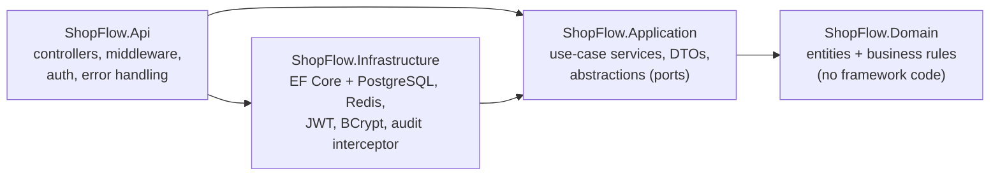

# ShopFlow — E-Commerce Backend (.NET 10)

ShopFlow is the backend REST API for an online store. It covers the main flow of a real shop:
**catalog → cart → checkout → payment → shipping**. It focuses on the parts that are easy to get
wrong in production:

- **Explicit transaction boundaries.** A checkout either fully happens or leaves no trace.
- **No overselling under concurrency.** It uses pessimistic row locks and a DB check constraint.
- **An append-only audit trail.** Every data change is recorded, and the database itself refuses to edit or delete audit rows.
- **Structured logging with correlation ids.** One id ties together a request's logs, its error response and its audit rows.
- **Redis** for the shopping cart and for the product cache.
- **Idempotent checkout**, so retries from the client are safe.
- **Docker Compose** for the full stack, and **tests that run against real PostgreSQL and Redis** through Testcontainers.

---

## Tech stack

| Area            | Technology |
|-----------------|------------|
| Runtime / API   | .NET 10, ASP.NET Core Web API (controllers), OpenAPI + Scalar UI |
| Database        | PostgreSQL 17, Entity Framework Core 10 (Npgsql), code-first migrations |
| Cache / Cart    | Redis 7 (StackExchange.Redis) |
| Auth            | JWT bearer tokens, BCrypt password hashing, role-based authorization (Customer / Admin) |
| Logging         | Serilog: structured JSON logs, request logging, correlation id enrichment |
| Testing         | xUnit, FluentAssertions, EF Core InMemory (unit), **Testcontainers** + `WebApplicationFactory` (integration) |
| DevOps          | Multi-stage Dockerfile (non-root), Docker Compose, GitHub Actions CI |

---

## Architecture

The code follows a layered (Clean Architecture style) structure. Dependencies point inwards.



```
src/
  ShopFlow.Domain/          Product, Order, OrderItem, Payment, User, AuditLog + domain exceptions
  ShopFlow.Application/     ProductService, CartService, OrderService, AuthService, AuditLogService
                            IUnitOfWork, IRowLocker, ICartStore, ICacheService, IPaymentGateway ...
  ShopFlow.Infrastructure/  AppDbContext, entity configs, migrations, AuditingInterceptor,
                            UnitOfWork, RowLocker, Redis cart/cache, JWT, simulated payment gateway
  ShopFlow.Api/             Controllers, CorrelationIdMiddleware, GlobalExceptionHandler, Program.cs
tests/
  ShopFlow.UnitTests/         domain rules + services with in-memory fakes (fast)
  ShopFlow.IntegrationTests/  full HTTP API against real PostgreSQL + Redis containers
```

**Domain model.** Business rules live in the entities. For example, `Product.ReserveStock` will not
let stock go negative, and `Order.Ship()` only works on a paid order. Services orchestrate these
rules and never change entity state directly.

---

## Key design decisions

### 1. Transaction boundaries

All multi-step writes go through `IUnitOfWork.ExecuteInTransactionAsync(...)`, which marks one
explicit database transaction. Checkout works like this:

```
BEGIN (READ COMMITTED)
  SELECT ... FROM products WHERE id = ANY(@ids) ORDER BY id FOR UPDATE   -- lock the rows
  validate every line, then reserve stock                                -- Order.Place(...)
  INSERT order, order_items
  UPDATE products (stock)
  INSERT audit_logs (one row per changed entity)                         -- same transaction
COMMIT
-- only after a successful commit:
  clear the Redis cart, invalidate the cached products
```

- If any line fails, for example because of insufficient stock, the **whole transaction rolls back**.
  The stock of the other lines is untouched, no order exists and no audit rows were written.
- **Redis side effects run only after the commit.** A rollback therefore never empties the customer's cart.
- Rows are locked **in a fixed order (by id)**, so two checkouts that touch the same products cannot deadlock.
- After a rollback, the EF change tracker is cleared, so in-memory state from the failed attempt cannot leak into a later save.

The other transactional operations are listed below:

| Operation | Inside the transaction |
|-----------|------------------------|
| Pay       | Lock the order row → charge (simulated) → insert the payment → mark the order Paid. A declined card is **also committed** as a `Declined` payment, so failed attempts stay traceable. The lock prevents double payment. |
| Cancel    | Lock the order → lock its products → return the stock → set status Cancelled. |
| Ship / Deliver | Lock the order → state transition (only valid transitions are allowed). |

### 2. Concurrency control

| Problem | Solution |
|---------|----------|
| Two customers buy the last unit at the same moment | Pessimistic lock (`SELECT ... FOR UPDATE`) during checkout. A `CHECK (stock_quantity >= 0)` constraint is the final safety net. |
| Two admins edit the same product | Optimistic concurrency with PostgreSQL's `xmin` as the row version. A client sends the `version` it read, and a stale update returns **409 Conflict**. |
| The client retries checkout after a timeout | `Idempotency-Key` header plus a unique index on `(customer_id, idempotency_key)`. A retry returns the original order (200) instead of creating a second one. |

### 3. Append-only auditing

`AuditingInterceptor` (an EF Core `SaveChangesInterceptor`) runs before every save. For every
entity marked with `IAuditable` it writes an `audit_logs` row containing:

- the entity type, entity id and action (`Insert` / `Update` / `Delete`)
- the changes as `jsonb`: `{ "StockQuantity": { "old": 50, "new": 48 } }`
- **who** made the change (user id from the JWT) and **which request** made it (correlation id)
- the timestamp

Append-only is enforced at **three levels**:

1. **Database.** The trigger `trg_audit_logs_no_update_delete` and the `TRUNCATE` trigger raise an
   error on any `UPDATE`, `DELETE` or `TRUNCATE`, even one sent from a SQL console with the app's credentials.
2. **Application.** The interceptor throws if EF tries to modify or delete an `AuditLog`.
3. **API.** There are only read endpoints (`GET /api/admin/audit-logs`).

Sensitive fields are excluded with `[AuditIgnore]`. For example, `PasswordHash` never reaches the audit log.

Because the audit rows are written in the **same transaction** as the business change, the audit
trail can never show a change that did not happen, and it never misses one that did.

### 4. Logging and observability

- **Serilog** writes structured logs. The output is JSON (one event per line, ready for ELK, Loki or Seq) in containers, and human-readable text in development.
- **`CorrelationIdMiddleware`** reads `X-Correlation-Id` from the request or generates one. It returns the id in the response and adds it to:
  - every log line of the request,
  - every audit row written by the request,
  - every error response (`correlationId` field in the ProblemDetails body).
- Request logging records method, path, status code, elapsed time and user id for every call.
- Business events are logged as structured events: `Order {OrderId} placed by {UserId} ... total {TotalAmount}`.
- Health checks: `/health/live` (liveness) and `/health/ready` (PostgreSQL + Redis).

### 5. Redis usage

- **Cart.** Each cart is a Redis hash (`shopflow:cart:{userId}` maps productId to quantity) with a
  7-day sliding expiry. Prices are **not** stored in the cart; they are always read from the
  database, so the customer pays the current price.
- **Product cache.** Cache-aside for `GET /api/products/{id}` and the product list.
  - Single products are removed from the cache on change.
  - All cached list pages are invalidated at once by bumping a version counter that is part of the cache key.
- **Resilience.** Cache errors are logged and ignored, so a Redis outage only makes the catalog slower and never takes it down.

### 6. Error handling

`GlobalExceptionHandler` maps exceptions to RFC 9457 **ProblemDetails** responses:

| Status | Cause |
|--------|-------|
| 400 | Validation errors |
| 401 | Not authenticated |
| 402 | Payment declined |
| 403 | Wrong role |
| 404 | Not found, including another customer's order (ids cannot be probed) |
| 409 | Out of stock, invalid state transition, stale version, duplicate |
| 422 | Other business rule violations |
| 500 | Unexpected errors (logged with the stack trace; details hidden from the client) |

---

## Running the project

### Option A — everything in Docker (recommended)

```bash
docker compose up --build
```

| What | URL |
|------|-----|
| API | http://localhost:8080 |
| API docs (Scalar UI) | http://localhost:8080/scalar/v1 |
| OpenAPI JSON | http://localhost:8080/openapi/v1.json |
| Health | http://localhost:8080/health/ready |

On startup, migrations are applied, an admin user is created and demo products are seeded:

- **Admin:** `admin@shopflow.local` / `Admin123!`

If ports 5432, 6379 or 8080 are already in use on your machine, override them:

```bash
POSTGRES_PORT=55432 REDIS_PORT=56379 API_PORT=58080 docker compose up --build
```

### Option B — run the API locally, with the infrastructure in Docker

```bash
docker compose up -d postgres redis
dotnet run --project src/ShopFlow.Api      # http://localhost:5080, Development settings
```

### Database migrations

```bash
dotnet tool restore
dotnet ef migrations add <Name> -p src/ShopFlow.Infrastructure -s src/ShopFlow.Infrastructure -o Persistence/Migrations
```

---

## Tests

```bash
dotnet test
```

Docker must be running: the integration tests start their own PostgreSQL and Redis containers.

**Unit tests (30)** cover domain rules and services:

- stock reservation and release
- order state machine
- price snapshots
- "no partial reservation" on failure
- cart validation
- caching and invalidation
- paging

**Integration tests (25)** run real HTTP calls against a real database:

| Test | What it proves |
|------|----------------|
| `Checkout_creates_order_reserves_stock_clears_cart_and_writes_audit_in_one_transaction` | The happy path, plus audit rows that carry the user id and correlation id |
| `Checkout_with_insufficient_stock_rolls_back_everything` | A rollback leaves no order, unchanged stock, **no audit rows** and the cart kept |
| `Concurrent_checkouts_for_the_last_unit_never_oversell` | 6 parallel buyers for 1 unit: exactly 1 succeeds and 5 get 409 |
| `Retried_checkout_with_same_idempotency_key_returns_the_original_order` | 3 parallel retries produce one order, and stock is reserved once |
| `Database_rejects_any_modification_of_audit_rows` | `UPDATE`, `DELETE` and `TRUNCATE` on `audit_logs` all fail |
| `Declined_payment_is_recorded_and_order_stays_pending_then_succeeds_on_retry` | Payment failure handling |
| `Stale_update_is_rejected_with_409_optimistic_concurrency` | `xmin` row versioning |
| `Cached_product_is_invalidated_after_update` | Redis cache invalidation |
| ... | Authorization rules, validation, health checks, order lifecycle |

CI (GitHub Actions) builds the solution, runs all tests and builds the Docker image on every push.

---

## API overview

| Method | Endpoint | Auth | Description |
|--------|----------|------|-------------|
| POST | `/api/auth/register` | – | Register a customer, returns a JWT |
| POST | `/api/auth/login` | – | Log in, returns a JWT |
| GET | `/api/auth/me` | user | Current user |
| GET | `/api/products?search=&page=&pageSize=` | – | List products (cached) |
| GET | `/api/products/{id}` | – | Product details (cached) |
| POST | `/api/products` | admin | Create a product |
| PUT | `/api/products/{id}` | admin | Update a product (send `version`; stale → 409) |
| POST | `/api/products/{id}/restock` | admin | Add stock |
| POST | `/api/products/{id}/deactivate` / `activate` | admin | Hide or show a product |
| GET | `/api/cart` | user | View the cart with current prices |
| POST | `/api/cart/items` | user | Add an item |
| PUT / DELETE | `/api/cart/items/{productId}` | user | Change the quantity or remove an item |
| POST | `/api/orders/checkout` | user | Create an order from the cart (`Idempotency-Key` header optional) |
| GET | `/api/orders` / `/api/orders/{id}` | user | My orders (admins see all) |
| POST | `/api/orders/{id}/pay` | user | Pay (`"paymentToken": "tok_declined"` simulates a declined card) |
| POST | `/api/orders/{id}/cancel` | user | Cancel and return the stock |
| POST | `/api/orders/{id}/ship` / `deliver` | admin | Fulfilment |
| GET | `/api/admin/audit-logs?entityType=&entityId=&userId=&correlationId=&from=&to=` | admin | Query the audit trail |

### Quick demo with curl

```bash
B=http://localhost:8080
TOKEN=$(curl -s -X POST $B/api/auth/register -H 'Content-Type: application/json' \
  -d '{"email":"me@example.com","password":"Passw0rd!","fullName":"Demo User"}' | jq -r .accessToken)

PRODUCT=$(curl -s "$B/api/products?search=keyboard" | jq -r '.items[0].id')

curl -s -X POST $B/api/cart/items -H "Authorization: Bearer $TOKEN" -H 'Content-Type: application/json' \
  -d "{\"productId\":\"$PRODUCT\",\"quantity\":2}"

curl -s -X POST $B/api/orders/checkout -H "Authorization: Bearer $TOKEN" \
  -H 'Idempotency-Key: order-001' -H 'X-Correlation-Id: demo-123' -H 'Content-Type: application/json' \
  -d '{"shippingAddress":"Baku, Akademik Hasan Aliyev st. 24"}'

# As admin: see everything that request changed
ADMIN=$(curl -s -X POST $B/api/auth/login -H 'Content-Type: application/json' \
  -d '{"email":"admin@shopflow.local","password":"Admin123!"}' | jq -r .accessToken)
curl -s "$B/api/admin/audit-logs?correlationId=demo-123" -H "Authorization: Bearer $ADMIN" | jq
```

---

## Possible next steps

- Transactional **outbox** for events such as "OrderPlaced" (emails, a warehouse system) instead of after-commit calls
- Integration with a real payment provider, with webhooks
- Refresh tokens and rate limiting on the auth endpoints
- OpenTelemetry tracing and metrics
- Hash-chained audit rows (each row stores the hash of the previous row) for tamper evidence even against database superusers
